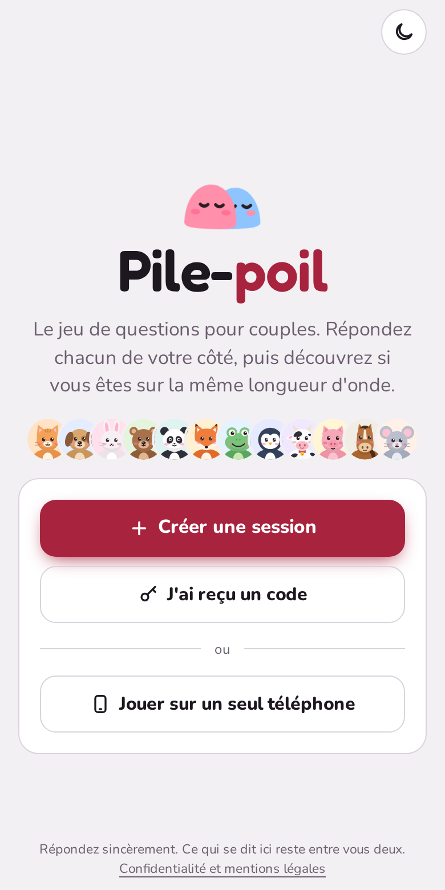
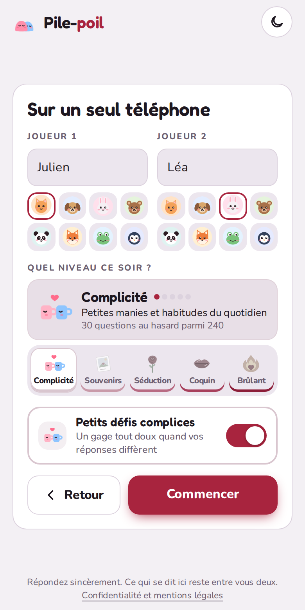
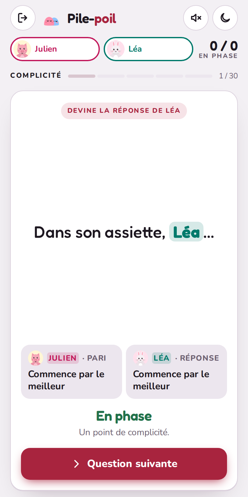

<p align="center">
  
</p>

<h1 align="center">Pile-poil</h1>

<p align="center">
  <strong>Le jeu de questions pour couples.</strong><br>
  Répondez chacun de votre côté, puis découvrez si vous êtes sur la même longueur d'onde.
</p>

<p align="center">
  <a href="https://mrddream.github.io/Pile-Poil/"><strong>▶ Jouer sur mrddream.github.io/Pile-Poil</strong></a>
</p>

<p align="center">
  
  &nbsp;
  
  &nbsp;
  
</p>

> Jeu réservé aux adultes : les niveaux 4 et 5 abordent la sexualité de façon explicite.

## Comment on joue

1. **Choisissez un niveau**, du plus tendre au plus osé, et la longueur de la partie : 10, 20 ou 30 questions tirées au hasard parmi les 240 du niveau.
2. **Répondez chacun de votre côté** : « Qui de nous deux… ? », ou devinez ce que l'autre va répondre.
3. **Les réponses s'affichent ensemble.** Même réponse : un point de complicité. Pas d'accord : on en parle… ou on relève un petit défi.
4. **Le bilan final** donne votre score de complicité, à garder en image ou en texte.

## Les cinq niveaux

| Niveau | Le thème | Les défis |
| --- | --- | --- |
| 1 · Complicité | Manies et petites habitudes | Tout doux et drôles |
| 2 · Souvenirs | Votre histoire, vos premières fois | Des moments à revivre |
| 3 · Séduction | Ce qui vous fait craquer | Charmeurs |
| 4 · Coquin | Ça chauffe sous la couette | Taquins |
| 5 · Brûlant | Fantasmes et envies inavouées | Osés |

Les défis sont facultatifs : on peut toujours passer son tour, ou les désactiver avant la partie.

## Fonctionnalités

- **Deux façons de jouer** : sur un seul téléphone qu'on se passe, ou sur deux téléphones reliés par un code (`K7QM-3XRP`).
- **Invitation en un geste** : le bouton « Partager » envoie un lien qui ouvre le jeu avec le code déjà rempli, ou l'autre téléphone scanne un QR code.
- **Parties de 10, 20 ou 30 questions**, et un bouton « Passer » pour une question qui ne vous inspire pas.
- **Réactions rapides** (cœur, rire, rougir) envoyées à l'autre téléphone au moment de la révélation, **sons doux** optionnels et transitions animées.
- **Bilan à partager** : votre score de complicité, vos désaccords, et l'image du bilan à envoyer en un geste.
- **Reprise de partie** : si l'app se ferme par erreur, une fenêtre propose de reprendre là où vous en étiez.
- **Application installable** (PWA) : sur l'écran d'accueil comme une vraie app, et le jeu à un téléphone marche hors connexion.
- **Pensé pour le téléphone** : chaque écran tient sans défiler, des petits écrans aux grands ; thème clair et sombre.
- **Respect de la vie privée** : pas de compte, pas de pub, pas de statistiques, pas de cookie. Détails dans [la page Confidentialité](https://mrddream.github.io/Pile-Poil/confidentialite.html).

---

## Pour les développeurs

Site statique en HTML, CSS et JavaScript, sans framework ni étape de build. Les sessions à deux téléphones passent par Firebase Firestore (formule gratuite).

### Structure

| Fichier | Rôle |
| --- | --- |
| `index.html`, `style.css` | La page et ses styles (thème clair et sombre, tailles adaptées à la hauteur de l'écran) |
| `app.js` | Le jeu : écrans, niveaux (`LEVELS`), défis (`DARES`), avatars, reprise de partie |
| `questions/` | Les questions, un fichier par niveau |
| `tools/check-questions.js` | Vérifie les fichiers de questions |
| `storage.js` | Le lien avec Firebase Firestore pour les sessions à distance |
| `firebase-config.js` | La configuration Firebase du site |
| `firestore.rules` | Les règles de sécurité de la base |
| `sw.js`, `manifest.webmanifest`, `icons/` | L'application installable et le mode hors ligne |
| `fonts.css`, `fonts/` | Les polices Fredoka et Nunito, servies par le site (licence OFL) |
| `vendor/qrcode.js` | Générateur de QR code (qrcode-generator, MIT) |
| `confidentialite.html` | Confidentialité et mentions légales |

### Tester en local

Il faut passer par un petit serveur web :

```bash
python3 -m http.server 8000
```

Puis ouvre http://localhost:8000.

### Ajouter ou modifier des questions

Chaque niveau a son fichier dans `questions/`. Il existe deux types de questions :

```js
{id:"a12",l:1,t:"who",q:"Qui de nous deux chante le plus faux ?"},
{id:"a13",l:1,t:"guess",q:"Le petit-déjeuner idéal de {X} ?",o:["Sucré","Salé","Juste un café","Rien du tout"]},
```

- `who` : « Qui de nous deux… », chacun désigne l'un des deux.
- `guess` : `{X}` est remplacé par le prénom d'un des joueurs, qui répond pour soi pendant que l'autre devine parmi les 4 options. L'élision est automatique : « de Anna » devient « d'Anna ».
- Un `id` ne doit jamais changer ni être réutilisé, car une partie en cours y fait référence.

Après une modification, lance la vérification (format, doublons entre niveaux, longueurs) :

```bash
node tools/check-questions.js
```

Les longueurs de partie proposées sont `LENGTHS` dans `app.js` (30 par défaut, `DECK_SIZE`).

### Héberger ta propre version

1. Fais un fork, puis active **Settings → Pages → Deploy from a branch → `main` / `(root)`**. Netlify, Cloudflare Pages ou Vercel marchent aussi, sans commande de build.
2. **Remplace `firebase-config.js` par ta propre configuration**, sinon ta version écrirait dans la base de ce site. Laisse `apiKey` vide si tu veux seulement le mode à un téléphone.
3. Pour ta base Firebase :
   - crée un projet sur https://console.firebase.google.com (formule Spark, gratuite et sans carte bancaire) ;
   - crée **Firestore Database** en mode production, région `eur3` (Europe) ;
   - colle `firestore.rules` dans l'onglet **Règles**, puis **Publier** ;
   - dans **Paramètres du projet → Vos applications → Web (`</>`)**, copie l'objet `firebaseConfig` dans `firebase-config.js`.

La clé `apiKey` de Firebase n'est pas un secret : c'est `firestore.rules` qui protège la base. Tu peux en plus la limiter à ton domaine dans Google Cloud Console (**API et services → Identifiants → Restrictions : Sites web**).

### Données et vie privée

- Quitter la partie supprime la session du serveur pour les deux joueurs.
- Le serveur ne garde que les prénoms, les avatars, la réponse en cours (remise à zéro à chaque question) et, pour chaque question jouée, « en phase » oui ou non. L'historique détaillé reste sur les téléphones, et il est effacé en quittant la partie ou au bout de 24 h.
- Les règles rendent illisible toute session inactive depuis 48 h. Les sessions abandonnées restent stockées jusqu'à ce que leur code soit réutilisé : vide la collection `sessions` dans la console Firebase de temps en temps. Le TTL automatique de Firestore n'est pas utilisé, car il exige la formule payante.

### Application installable (PWA)

`sw.js` sert toujours la version en ligne quand le réseau est là, donc une mise à jour du site arrive tout de suite, et garde une copie pour le mode hors ligne. Si tu ajoutes un fichier au site (une page, un fichier de questions…), ajoute-le aussi à la liste `SHELL` de `sw.js`.

## Licence

Code sous licence [MIT](LICENSE). Polices Fredoka et Nunito sous licence SIL Open Font License 1.1.
